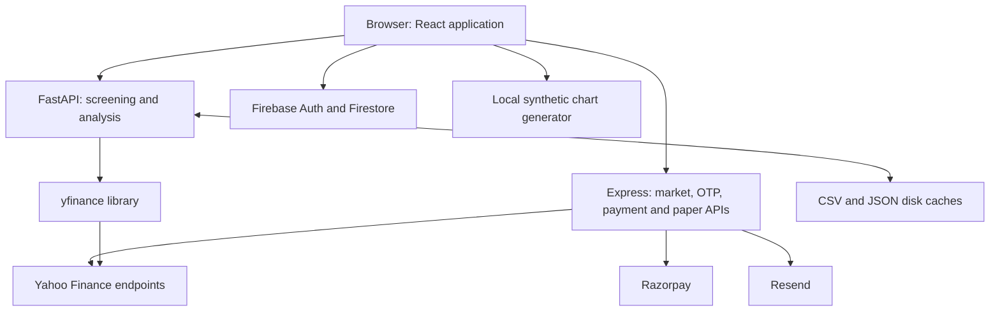

# NiftyLens — Complete Product & Feature Analysis

Analysis date: 19 November 2026.

Scope: read-only inspection of `/Users/ashwinkumar/grow-paper-trading` and the supplied backend, `/Users/ashwinkumar/trade-bot/backend`. This report is the only file created. Application code, dependencies, configuration, databases, and existing documentation were not changed. No commits were made.

Method: inspected application routes, components, hooks, engines, API handlers, models, manifests, configuration, Firestore rules, tests, and relevant existing cache metadata. Traced user workflows to their data sources. Reviewed official partner documentation for section 12. Did not run the application, tests, build, browser flows, payments, authentication, or fresh scans/backtests. Production configuration and deployed behavior remain unverified. No credentials are reproduced.

## 1. Executive Summary

NiftyLens combines Indian equity paper trading, technical stock screening, individual stock analysis, and interactive chart education in a single web application. Substantial functionality exists beyond the landing page: a simulated order engine, portfolio accounting, swing and intraday scanners, a Python backtester, 21 interactive pattern templates, and three Guess the Chart modes.

Its strongest supported proposition is **learn a chart concept, examine an algorithmic setup, and practise a decision without placing a real securities order**. The education module can operate independently of external market feeds because its charts are generated locally.

The implementation is not yet sufficient evidence for claims of production readiness, exchange-grade execution, licensed real-time redistribution, AI-generated research, or independently validated trading performance. Important distinctions are:

- **Screening is rule based.** Python indicators, pattern conditions, and weighted scores drive the analysis. An installed Google GenAI dependency is not called by the inspected application.
- **Guess the Chart uses synthetic scenarios.** It does not replay actual historical stock sessions. Users choose BUY or SELL, then see the generated continuation.
- **Market-data fallbacks are substantial.** Quotes can fall back to seeded values; charts and fundamentals can be fabricated; screener API failures produce generated research, signals, and financials.
- **Backtesting exists, but its labels overstate validation.** A single chronological split does not implement the reported four-fold walk-forward process. Some displayed strategy statistics are hardcoded defaults.
- **Commercial infrastructure is incomplete.** Google authentication and Razorpay API paths exist, but email identity, Firestore rules, server authorization, payment entitlements, and recurring subscription reconciliation need significant hardening.
- **Data permissions are unresolved.** Current code uses Yahoo Finance endpoints and yfinance. No broker or commercial data-provider integration or redistribution agreement was verified.

A credible partnership discussion can start with an honestly labelled product demonstration and an education pilot proposal. A market-connected commercial pilot should first resolve data provenance, access control, payment integrity, and validation claims.

## 2. What is NiftyLens?

NiftyLens is a browser application for people learning to interpret Indian stock charts and practise equity trading. It serves four connected activities:

1. **Learn:** explore chart-pattern explanations and generated examples.
2. **Predict:** choose a direction before a generated chart continuation is revealed.
3. **Analyse:** inspect stocks, technical signals, trade levels, and historical strategy summaries.
4. **Practise:** place simulated orders and review virtual holdings, positions, and profit or loss.

The inspected product focuses on cash-equity-style simulation and NSE-oriented research. Index displays do not establish index trading, futures, options, commodities, or currency trading support. Search may return other Yahoo instruments, but downstream symbol handling does not establish reliable multi-exchange coverage.

There is no implemented real brokerage order routing, demat account opening, broker portfolio import, withdrawal of virtual funds, or exchange matching engine. Subscription payments buy software access or virtual capital; simulated trading balances are separate from real securities funds.

### Evidence references

The following source groups keep references readable throughout the report. `F/` means the frontend repository above; `B/` means the supplied Python backend. Paths identify inspected implementation, not proof of production deployment.

| Reference | Relevant source files |
|---|---|
| E1 — Application and routes | `F/src/App.tsx`, `F/src/app/WorkspaceContent.tsx`, `F/src/app/GlobalOverlays.tsx`, `F/src/lib/navigation.tsx` |
| E2 — Landing and public content | `F/src/components/LandingPage.tsx`, `F/src/components/landing/*`, `F/src/components/LearningSection.tsx`, `F/src/components/LegalPages.tsx`, `F/src/components/legal/LegalPageContent.tsx` |
| E3 — Market APIs and integrations | `F/server.ts`, `F/src/features/virtual-trading/services/marketData.ts`, `F/src/data/mockStocks.ts` |
| E4 — Quotes and stock views | `F/src/features/virtual-trading/hooks/useMarketQuotes.ts`, `usePortfolioQuotes.ts`, `useStockDetails.ts`; corresponding `components/StockChart.tsx`, `StockDepth.tsx`, `StockFundamentals.tsx`, `StockSearchModal.tsx`, `ExploreView.tsx` |
| E5 — Order execution and accounting | `F/src/utils/orderEngine.ts`, `charges.ts`, `portfolio.ts`, `marketHours.ts`; `F/src/features/virtual-trading/hooks/useOrderExecution.ts`, `useOrderEngine.ts`, `useIntradaySquareOff.ts`, `usePortfolioSummary.ts` |
| E6 — Accounts, storage, watchlists, wallet | `F/src/context/TradingContext.tsx`; `F/src/features/virtual-trading/hooks/useTradingPersistence.ts`, `useAccountSync.ts`, `useUsageQuota.ts`, `useWalletActions.ts`, `useWatchlistActions.ts`, `useWatchlistView.ts`; corresponding `utils/portfolioSync.ts`, `userProfileSync.ts`, `storageKeys.ts` |
| E7 — Authentication | `F/src/lib/firebase.ts`, `F/firestore.rules`, `F/src/components/auth/useAuthModal.ts`, `F/src/features/virtual-trading/hooks/useSignIn.ts`, `useSignUp.ts`, `useSignOut.ts`, `F/server.ts` |
| E8 — Plans and payments | `F/src/lib/subscription.ts`, `F/src/features/pricing/pricingConfig.ts`, `F/src/utils/pricing.ts`, `F/src/components/checkout/*`, `F/src/components/profile/*`, `F/src/features/virtual-trading/hooks/useSubscriptionActions.ts`, `F/server.ts` |
| E9 — Screener interface and fallback data | `F/src/features/screener/api/client.js`, `App.jsx`, `hooks/useSwingScanner.js`, `hooks/useIntradayScanner.js`, `hooks/useStockAnalysis.js`, `utils/scanCache.js`, `utils/screenerHelpers.ts`, `pages/*`, `components/*` |
| E10 — Python service and data | `B/app/main.py`, `app/config.py`, `app/api/routes.py`, `app/models/schemas.py`, `app/data/provider.py`, `cache.py`, `nse_calendar.py`, `nifty500_constituents.py`, `ind_nifty500list.csv` |
| E11 — Analytics engine | `B/app/engine/indicators.py`, `patterns.py`, `strategies.py`, `scoring.py`, `scanner.py` |
| E12 — Backtesting | `B/app/engine/backtester.py`, `B/scripts/fetch_historical_data.py`, `scripts/run_backtests.py`, `B/data_cache/artifacts/backtest_report.json` |
| E13 — Quiz generation and evaluation | `F/src/features/quiz/utils/dataGenerator.ts`, `evaluatePrediction.ts`, `indicators.ts`, `patternCatalog.ts`, `F/src/features/quiz/types/trading.ts` |
| E14 — Quiz interaction and persistence | `F/src/features/quiz/QuizApp.tsx`, `hooks/*`, `components/TradingCanvas.tsx`, `ActionDock.tsx`, `OutcomeModal.tsx`, `HistoryDrawer.tsx`, `SurvivalGameOverModal.tsx`, `TournamentResultModal.tsx`, `utils/sound.ts`, `utils/celebration.ts` |
| E15 — Learning | `F/src/features/quiz/components/LearnChartsPage.tsx`, `PatternCatalog.tsx`, `PatternDemonstration.tsx`, `PatternExplanation.tsx`, `PatternGuideModal.tsx`, `OutcomeLessonContent.tsx`, `OutcomeCheatSheetViewer.tsx`, `hooks/usePatternLesson.ts` |
| E16 — Tooling and tests | `F/package.json`, `F/tsconfig.json`, `F/vite.config.ts`, `F/eslint.config.mjs`, `F/src/utils/*.test.ts`, `B/pyproject.toml`, `B/tests/*` |

## 3. Complete Feature Inventory

Status definitions apply throughout:

- **Fully implemented (F):** a complete code path exists for the bounded feature described. This does not mean it was executed or certified in this audit.
- **Partially implemented (P):** meaningful implementation exists, but a dependency, correctness issue, integration, or enforcement gap prevents an unqualified claim.
- **UI only / mocked (M):** presentation or generated data stands in for the claimed external capability.
- **Planned but not implemented (N):** an advertised/configured intention has no corresponding implementation. This is not confirmation of a committed roadmap.
- **Unable to verify (U):** source inspection cannot establish the claim or operational condition.

| Feature | Status | Evidence and qualification |
|---|---|---|
| Landing page, pricing, FAQs, product navigation | F | Components and route handling exist. E1–E2. |
| Landing market ticker | P | Market API integration with seeded fallback values. E2–E4. |
| Landing screener and AI preview cards | M | Static example signals and scores; not live scans. E2. |
| Guest chart challenge | F | Generated interactive preview; two completed guest rounds per browser. E2, E13. |
| Public learning and legal/contact pages | F | Routes and content exist; no ticketing or automated refund service. E1–E2, E15. |
| Responsive layouts, theme preference, loading/empty/error UI | F | Dedicated mobile/desktop components, theme persistence, gates and states; browser accessibility unverified. E1, E4, E9, E14. |
| Trading workspace, market overview, sector discovery | F | Explore, holdings, watchlist, orders, stock detail, indices and movers. E4–E6. |
| Popular stocks and market movers | P | Movers use available catalog quotes; popularity is curated, not measured user trading activity. E3–E4. |
| Stock search and monitored quotes | P | Yahoo search and polling exist; fallback, symbol and freshness limitations apply. E3–E4. |
| Historical line/candlestick charts and terminal indicators | P | API charts and controls exist; generated fallback bars can replace history. E3–E4. |
| Five-level order book / market depth | M | Bid/ask prices, quantities and counts are generated locally. E3–E4. |
| Trading-page fundamentals | M | Many ratios are constants or price-derived placeholders. E3–E4. |
| Virtual starting balances and simulated account | F | Plan-specific balances and portfolio state. E5–E6, E8. |
| Delivery buy/sell, MIS long/short, MTF simulation | F | Holdings, margin and loan accounting implemented within simulation limits. E5. |
| MARKET, LIMIT, SL and SL-M orders | F | Validation, triggers, reservations and execution paths exist. E5. |
| Pending order processing, cancellation and expiry | F | State transitions, refunds, FIFO processing and duplicate protection. E5. |
| After-market order scheduling | F | Next-session scheduling exists; advertised Advanced-only restriction is not enforced. E5, E8. |
| Partial fills based on real liquidity | P | Engine supports a liquidity input, but normal application calls do not supply real depth. E5. |
| Market-hours and quote-freshness controls | P | Calendar and staleness rules exist; fallback labels and differing calendars weaken them. E3, E5, E10. |
| Automatic intraday square-off | P | Browser timer and catch-up logic exist; unattended server execution is not guaranteed. E5. |
| Holdings, positions, P&L, estimated charges, order history | F | Accounting and views exist; results remain simulation estimates. E5–E6. |
| Durable, authoritative trading ledger | P | Browser/Firestore persistence and an in-memory server mirror; client state is trusted. E3, E6–E7. |
| Watchlist creation, selection, add/remove and limits | F | Plan-based counts and stock limits; no rename/delete workflow found. E6, E8. |
| Watchlist quote restoration for all searched symbols | P | Symbols outside the hydrated stock collection can disappear from the view. E4, E6. |
| Paid virtual top-ups, manual resets and monthly capital refresh | P | Implemented actions, but cap/restore and monthly accounting inconsistencies exist. E6, E8. |
| NIFTY-oriented swing scanning | P | Real Python scanner plus generated client fallback; universe and data-age caveats. E9–E11. |
| Signal sorting, filters, details and trade levels | F | Confidence, sector, signal status and detail views implemented. E9. |
| Intraday scanning and five-minute refresh | P | Rules and scheduling exist; freshness, sample and result-cap limitations apply. E9–E11. |
| Stock analysis: BUY/WAIT/AVOID, chart, reasons and risks | P | Real rule engine exists; failures can return synthetic analysis. E9–E11. |
| Quarterly/annual financials in stock analysis | P | yfinance statements and cache, with fabricated client fallback. E9–E10. |
| Support/resistance and advanced technical details | P | Implemented; actual gating differs from some Beginner-plan descriptions. E8–E9, E11. |
| Nine swing and three intraday strategies | F | Explicit indicator conditions; not machine learning models. E11. |
| Backtest computation and report API | P | Simulation engine exists; validation and reporting qualifications are material. E10–E12. |
| Standalone backtest runner in the web UI | U | Backend endpoints/scripts exist, but no connected report/rerun page or committed UI roadmap was found. E9, E12. |
| Calibrated success probabilities / guaranteed precision | U | No independent calibration or reproducible validation established. E11–E12. |
| AI-generated stock research | M | AI-labelled presentation; analysis is templates and rules, with no AI service call. E2, E9, E11, E16. |
| Analysis-to-paper-trading navigation | F | Opens/selects a stock; does not submit or fully prefill an order. E9. |
| 21-pattern interactive learning library | F | Pattern descriptions, categories, difficulty and generated demonstrations. E13, E15. |
| “28+ patterns,” achievements and course completion | N | Advertised claims exceed the implemented library/progress system. E2, E13–E15. |
| Guess the Chart prediction, reveal and explanations | F | BUY/SELL decisions, generated continuation, price-based evaluation. E13–E14. |
| Practice, Survival and local Tournament modes | F | Counters, lives/streak scoring, ten-round tournament. E14. |
| Chart controls, overlays, keyboard shortcuts and feedback | F | Canvas interaction, indicators, sound and win celebration. E13–E14. |
| Quiz journal and persistent progress | P | Browser-local history and statistics; account isolation and balance display issues. E14. |
| Quiz difficulties and tier restrictions | P | Difficulty/mode/quota gates exist; history permission flag is unused. E8, E14. |
| Google login | P | Firebase popup and identity listener; deployed setup and account security unverified. E7. |
| Email OTP login | P | Resend verification exists, but no Firebase token or authenticated server session follows. E7. |
| Profile, logout and subscription display | F | Identity, plan, quota, balance and account actions are rendered. E6–E8. |
| Free, Beginner and Advanced plans | P | Configuration and UI gates exist; enforcement is largely client-side. E8. |
| Razorpay checkout and signature verification | P | Real API paths coexist with demo bypass and incomplete entitlement binding. E8. |
| Subscription upgrade, renewal/status, cancellation and history | P | UI/API actions exist; webhook reconciliation and upgrade lifecycle are incomplete. E8. |
| Refund handling | P | Published policy/contact path; no refund-processing API found. E2, E8. |
| Broker/provider adapters | N | Configuration hints exist, but adapter implementations are absent. E10. |
| Licensed commercial feeds | U | Commercial access and redistribution permissions were not verified. E10. |
| Live deployments, scalability, measured learning/business outcomes | U | No runtime tests, production access or verified metrics in this audit. E16. |

## 4. Detailed Feature Explanations

### 4.1 Paper trading

**Account and capital.** A new Free account starts with ₹1,00,000 of virtual cash. Beginner and Advanced use ₹10,00,000 and ₹50,00,000 respectively. The account tracks cash, invested holdings, intraday margin, MTF loans, reserved funds, realized results, charges and orders. These are simulated records, not broker balances. E5–E6, E8.

**Products.** Delivery/CNC supports buying holdings and selling owned quantities. MIS supports intraday long and short positions, additions, partial exits and reversals, using a fixed 5× simulation. MTF models a 20% cash contribution and 80% financed purchase, with proportionate loan repayment on sale. It does not establish real financing, interest accrual, margin calls, broker eligibility, settlement or corporate-action processing. E5.

**Orders.** MARKET uses the available last price with a ₹0.05 tick rule. A buy LIMIT fills at an eligible price at or below its limit; a sell LIMIT at or above it. SL becomes a limit order after its trigger; SL-M becomes a market order. The engine validates whole quantities, prices, permitted products, available cash/holdings, estimated fees, price bands and quote freshness. It reserves required resources and records rejected submissions. E5.

Pending and scheduled orders can execute, be cancelled, or expire. Cancellation releases reservations. FIFO processing and idempotency identifiers reduce duplicate execution. Partial-fill mechanics exist in the engine, but no real liquidity feed drives normal fills; realistic queue position, spread, market impact and depth consumption are not modelled. E5.

**Market hours.** The frontend uses IST sessions, weekends, holiday tables and special-session configuration. Closed-market orders can be scheduled for the next session. Quotes are classified approximately as live up to two minutes old, delayed up to fifteen minutes, and stale thereafter; delayed quotes can still be tradable. These are application rules, not measured provider latency guarantees. Frontend and Python holiday definitions are not fully aligned. E3, E5, E10.

**Square-off.** Browser logic checks approximately every ten seconds and attempts to close MIS positions after 15:20, adding a simulated ₹59 square-off charge. It also attempts catch-up when the app resumes. This does not guarantee execution at 15:20 while the browser is closed. Catch-up can use fallback/entry-related prices when quotes are missing. E5.

**Accounting and review.** Holdings display quantity, average cost, investment, current value and P&L; intraday positions show direction, margin and open results. Orders have desktop/mobile lists, filters and detail views. Charges estimate brokerage, STT, exchange charges, SEBI charges, IPFT, stamp duty, GST and delivery DP charges. The portfolio utility accounts for loans, reserved funds and margin; a separate summary hook uses a different aggregation, so reconciliation needs testing. No claim is made that these estimates match every broker or current statutory tariff. E5–E6.

**Persistence.** Local account storage and Firestore save state, while Express maintains an in-memory mirror. The browser executes an order first and posts state to `/api/paper-trading/sync`. This is not a server-authoritative ledger. The server queue timer runs every fifteen seconds against last-known quotes; it does not independently maintain a fresh market stream. Restarts lose its memory, and reconnect synchronization can overwrite competing state. E3, E5–E7.

**Virtual capital.** Paid plans can top up within configured caps and reset the simulation. Free users can buy ₹1,00,000 additional virtual cash for ₹50 through the checkout path. That top-up can conflict with restoration logic that clamps Free balances to ₹1,00,000. Monthly refresh sets cash/initial capital to the tier amount while retaining holdings, positions and orders; it is triggered by application activity, not a durable monthly server job. Manual reset clears trading state and applies plan limits. E6, E8.

### 4.2 Market overview, charts and watchlists

The trading workspace contains Explore, Holdings, Watchlist and Orders tabs plus stock detail. It shows NIFTY 50, SENSEX, BANK NIFTY, NIFTY IT and NIFTY AUTO indices, a stock catalog, sectors, movers and curated popular stocks. Movers describe the available catalog, not a demonstrated full-exchange ranking. E3–E4.

Stock charts offer line/candlestick views, hover OHLCV, terminal-style overlays and nine ranges: 1D, 1W, 1M, 3M, 6M, 1Y, 3Y, 5Y and ALL. A five-year chart option does not mean the analysis backtester uses five years. Intraday display updates can create client-side bars from polled quotes. When external history fails, generated bars can replace it without a sufficiently clear synthetic label. E3–E4.

The five-level depth view is generated from the stock price, including quantities and order counts. Its “NSE”/“live” styling does not correspond to an exchange order-book integration. Trading-page ratios such as P/E, P/B and ROE also include constants or fabricated derivations. The separate stock-analysis financial endpoint is a different, partially real integration. E3–E4, E9–E10.

Users can create/select watchlists and add/remove symbols, with plan limits. Rename/delete workflows were not found. Lists resolve against the currently available stock collection; a searched symbol outside that collection may not reappear after reload unless another portfolio workflow hydrates its quote. E6.

### 4.3 Swing screener

The frontend requests a nominal 500-stock scan. Python loads a bundled constituent CSV, obtains adjusted daily OHLCV, computes indicators and patterns, evaluates strategy conditions, and ranks bullish candidates. Filters cover confidence, sector, and confirmed versus projected setups; rows open explanations, risks, entry, target, stop and reward/risk details. E9–E11.

The inspected CSV contains **501 unique symbols**, and its current official membership was not independently verified. Selection prioritizes static index tiers; cached symbols can expand the requested sample. Therefore “scanned 500” and “NIFTY 200 on Beginner” should not be treated as exact enforced coverage claims. The frontend requests the broader universe and applies result limits. E9–E10.

Nine swing strategies are implemented:

| Strategy identifier | Main idea |
|---|---|
| `EMA_SMA_GOLDEN_PULLBACK` | Pullback within an established moving-average trend |
| `MACD_MOMENTUM_SURGE` | Momentum confirmation through MACD and supporting conditions |
| `RSI_SUPPORT_BOUNCE` | RSI recovery with support/trend context |
| `BREAKOUT_VOLUME_CONFIRM` | Price breakout with volume confirmation |
| `BOLLINGER_SQUEEZE_BREAKOUT` | Expansion after a volatility squeeze |
| `BREAKOUT_RETEST_SUPPORT` | Retest of a previous breakout/support area |
| `VWAP_ACCUMULATION_TREND` | Price/volume positioning around VWAP and trend |
| `CANDLESTICK_PATTERN_CONFIRM` | Bullish candlestick confirmation |
| `MULTI_FACTOR_HIGH_PRECISION_ENSEMBLE` | Agreement among multiple rule conditions |

Indicators include EMA 9/20/50/200, SMA 20/50/200, RSI 14, MACD 12/26/9, Bollinger Bands, ATR, ADX/directional indicators, volume ratios, VWAP and prior highs/lows. Pattern detection includes engulfing candles, hammer, morning star, marubozu, breakouts/retests, ascending triangle and double bottom, plus bearish warnings such as shooting star and support breakdown. These detectors differ from the education library. E11.

Scores combine indicator agreement, triggers, pattern heuristics and penalties. They are not calibrated probabilities. Cached backtest statistics are used when available; otherwise constants supply strategy performance context. Target and stop levels derive from volatility and price levels, with projected dates/windows. These are analytical references, not guaranteed outcomes. E11–E12.

The swing scan is manually initiated; previous results may be restored. Advanced can force data refresh. Browser scan caches have no expiry, and Python can prefer stale disk data unless refreshed. API failure instead produces a 22-stock generated response. E9–E10.

### 4.4 Intraday screener

The intraday engine uses 15-minute candles, normally requesting five days of history. Its strategies are `INTRADAY_ORB_VWAP_BREAKOUT`, `INTRADAY_VWAP_EMA9_PULLBACK`, and `INTRADAY_MOMENTUM_IGNITION`. These are bullish/long setup scans, even though the paper engine separately supports short MIS trades. E10–E11.

Signals carry entry, stop, target, confidence and status. The scanner walks subsequent bars to determine target/stop outcomes, prioritizing the stop when both are touched. A closed signal is a modelled opportunity outcome, not proof a user executed that trade. There are spacing and session-end rules; the end-of-session implementation is not an exchange execution guarantee. E11.

Unlocked users load available results, while Advanced has a five-minute countdown/refresh during market hours. A Python startup task also refreshes on a five-minute cadence. The client typically requests 100 symbols; the scheduler requests 80, and cache selection can expand these. The backend returns at most 60 signals, despite an Advanced UI allowance of 100. Outside market hours, the previous session can be shown. E9–E11.

Free access is locked and Beginner displays up to five results without automatic refresh. Generated fallback results can appear when the API fails, so a functioning table is not proof of a live scan. E8–E9.

### 4.5 Individual stock analysis

Search supports suggestions, keyboard navigation, common-symbol shortcuts and a symbol in the URL. The backend normally requests two years of adjusted daily history, requires at least 55 bars, and returns approximately 90 recent bars for display. Simple analysis includes a stock overview, BUY/WAIT/AVOID assessment, confidence, chart and reference entry/target/stop. Advanced adds deeper reasons, risks, indicator readings, patterns, support/resistance, historical statistics and a strategy checklist. E9–E11.

BUY requires combinations of score, moving-average alignment, RSI limits and absence of bearish conditions. WAIT and AVOID follow weaker trend/score conditions. Explanations are generated from deterministic text templates. There is no model prompt, LLM request or learned classifier in this path. E11.

Beginner and Advanced have access to financial statements, but support/resistance detail is rendered inside the Advanced-only section despite Beginner marketing language. Cached analysis has no explicit expiry, and quota consumption can occur even for a repeat cached search or a failed attempt. The “paper trade” action selects the stock and navigates to trading; it does not execute the suggestion or automatically transfer every trade parameter. E8–E9.

Financials normally come from yfinance income statements, quarterly statements and company information, with a 24-hour JSON cache. On API error, the frontend can manufacture revenue/profit series and label them “NSE Consolidated Filings.” That label is not reliable evidence of an NSE filing integration. E9–E10.

### 4.6 Authentication, subscriptions and account management

Google login uses Firebase Authentication. Email login sends a six-digit OTP using Resend; server memory tracks ten-minute expiry and a five-attempt limit. A frontend resend countdown exists, but a corresponding server-side resend rate limiter was not found. Successful OTP verification returns an email, after which the browser builds a local user identity; it does not receive a Firebase custom token or authenticated server session. E7.

Profiles and subscription information are stored in Firestore, including email-based lookup to retain plans across login methods. The checked-in rules permit broad access to certain identity prefixes and email-indexed records. Server APIs do not verify Firebase identity before accepting account/payment-related requests. This creates material account and entitlement risks; deployed rules were not tested. E7–E8.

| Configured allowance | Free | Beginner | Advanced |
|---|---|---|---|
| Monthly / annual price | ₹0 | ₹299 / ₹2,899 | ₹699 / ₹6,699 |
| Starting virtual capital | ₹1 lakh | ₹10 lakh | ₹50 lakh |
| Watchlists × stocks | 1 × 10 | 3 × 25 | 50 × 100 |
| Swing results | 3 | 15 | Up to 500 configured |
| Intraday results | Locked | 5; manual refresh | 100 configured; backend currently caps 60 |
| Daily stock analyses | 3 | 15 | Effectively unlimited sentinel |
| Analysis depth | Simple | Financials | Advanced details/backtests |
| Order types | MARKET | MARKET, LIMIT | MARKET, LIMIT, SL, SL-M |
| Trading products | Delivery | Delivery, MIS, MTF | Delivery, MIS, MTF |
| Manual portfolio reset | Locked | Available | Available |
| Learning library | First 8 templates | All 21 | All 21 |
| Quiz allowance | 5 rounds/day | Effectively unlimited | Effectively unlimited |
| Quiz modes | Practice | Practice, Survival | Practice, Survival, Tournament |
| Difficulty | Beginner | Beginner, Intermediate | All levels |

Prices and allowances above are code configuration, not independently checked current commercial offers. “Unlimited” uses a large numeric sentinel. Daily usage is chiefly client/Firestore state. The AMO and quiz-history permission flags are not consistently enforced; Free library access means the first eight templates, not eight Beginner patterns. E8, E13–E14.

Razorpay integration creates recurring subscriptions/plans and ordinary orders for virtual-money purchases. Checkout loads Razorpay's browser SDK and sends signatures for server HMAC verification. Missing credentials enable a demo success path, and demo-prefixed order identifiers are also accepted by verification. Verified payment data is not robustly bound to a durable server-side user, amount and entitlement record. E8.

The Beginner-to-Advanced difference is ₹400 monthly or ₹3,800 annually, using a flat tier-price difference rather than elapsed-time proration. The old recurring subscription is not demonstrably cancelled when a replacement is created. Webhooks validate a signature when configured but only log lifecycle events; they do not persist renewal/failure/refund entitlement changes. Cancellation and status API calls exist, but full recurring lifecycle reconciliation remains partial. E8.

The profile shows identity, membership, plan, expiry/status, quota, wallet and billing history, with upgrade/renew/cancel/logout actions. Billing history combines stored records with Razorpay invoice/payment lookups and receipt links. Virtual-money top-ups are separated from subscription history. No self-service profile deletion, password reset, comprehensive profile editing, or automated refund execution was found. E6–E8.

## 5. Guess the Chart – Detailed Analysis

### 5.1 Beginner experience

A user chooses a mode and difficulty, sees a chart with its future hidden, and studies the visible candles. They can zoom, pan, inspect prices and optionally show indicators. They choose **BUY** if they expect the next section to rise, or **SELL** if they expect it to fall. There is **no WAIT answer** in this game; WAIT belongs to stock analysis.

After submission, hidden candles appear progressively, approximately every 75 milliseconds. The final price determines the result. A result panel explains the pattern, the expected reasoning, visual clues, a suggested entry trigger, stop reference and target guidance. The user can inspect the chart, open a guide, continue, or retry when a mode ends. Sound and confetti provide feedback. E13–E15.

### 5.2 How scenarios are created

`dataGenerator.ts` contains 21 templates with randomized price movement, wicks, volume and outcome continuations. Eight familiar stock names supply labels and starting-price context: RELIANCE, TCS, HDFCBANK, INFY, ICICIBANK, SBIN, ITC and LT. Timeframe labels include 5-minute, 15-minute, hourly and daily.

These are **synthetic teaching scenarios**, not downloaded historical candles or verified future outcomes for those companies. Stock/timeframe selection does not cause a provider request. Direction-selection logic balances recent intended biases and discourages repeated directions; it does not guarantee a perfectly balanced realized win distribution. E13.

### 5.3 Complete pattern catalog

| Group | Implemented templates |
|---|---|
| Reversal — 6 | Double Top; Head and Shoulders; Rising Wedge Reversal; Double Bottom; Inverse Head and Shoulders; Falling Wedge Reversal |
| Continuation — 6 | Falling Wedge Continuation; Bullish Rectangle; Bullish Pennant; Rising Wedge Continuation; Bearish Rectangle; Bearish Pennant |
| Bilateral — 3 | Ascending Triangle; Descending Triangle; Symmetrical Triangle |
| Special — 6 | Fake Dip Trap / Wyckoff Spring; Bull Trap Upthrust / UTAD; Parabolic Blow-Off Climax; Institutional Absorption / Wyckoff Markup; Trampoline Bounce / Trend Line; Broken Floor Slip / Trendline Breakdown |

There are 8 Beginner, 9 Intermediate and 4 Advanced templates. Some nominally bilateral templates have a coded directional bias; they do not cover every real-market resolution equally. The free library exposes the first eight templates in source order, including Intermediate examples. The advertised “28+” total is not supported by this catalog. Backend candlestick detectors such as hammer and engulfing are separate from these 21 educational scenarios. E13, E15.

### 5.4 Correctness and simulated P&L

Entry is the last visible setup candle's close. Exit is the final revealed candle's close. BUY wins if exit is higher; SELL wins if exit is lower. An unchanged price counts as a loss for either choice. The evaluator checks realized generated prices, not merely the template's intended direction. E13–E14.

Simulated P&L applies the signed percentage movement to the chosen position size. There is no brokerage, slippage, stop execution, target execution or leveraged position model in this quiz calculation. A displayed lesson stop/target is educational guidance, not an instruction executed by the game. Quiz capital is separate from the main paper portfolio. E13–E14.

### 5.5 Modes, scores and progress

| Mode | Implemented behavior |
|---|---|
| Practice | Correct/incorrect counts, accuracy, current/best streak and recent results; repeated directional exercises. |
| Survival | Starts with three lives; incorrect decisions consume a life. Correct answers earn streak-scaled points, from 100 to 500; best score persists locally. |
| Tournament | Ten local rounds, initial virtual balance of 10,000, adjustable position size bounded by available balance, cumulative P&L and a final trade summary. |

“Tournament” is a single-user session. No matchmaking, shared leaderboard, other participants, real prize or payout was found. Some quiz screens use dollar labels despite the application's Indian market context. E14.

The journal stores decisions and explanations and displays win/loss measures, net result, best streak, category performance and profit factor. History reset asks for confirmation. Persistent quiz data is stored in browser-local keys that are not scoped to the signed-in account; it is not synchronized as a learning record in Firestore. Active Survival/Tournament sessions are primarily in memory. A stored summary balance is not updated consistently with trade history. E14.

There is no implemented badge/achievement engine, completed-course tracker, certificate, or measured learning improvement. The plan flag intended to restrict the history drawer is unused. E8, E14–E15.

### 5.6 Chart interaction and educational value

The Canvas 2D renderer supports candles/line views, zoom controls and wheel zoom, pointer/touch panning, recentering, a crosshair, OHLC inspection, entry/future markers, volume, EMA 20, SMA 50, RSI 14 and level overlays. Revealed information follows the game phase. Keyboard shortcuts include B/S for directions, Enter/Space for continuation and Escape for closing relevant overlays, with guards around editable controls. Timers are cleaned up on unmount. E13–E14.

The educational value comes from making a decision before receiving feedback and then comparing that decision with an explained outcome. It is more active than reading a static pattern diagram. However, generated textbook-like setups and endpoint scoring do not establish transferable profitability or realistic execution skill. No user study or learning-effectiveness measurement was verified.

## 6. Complete User Journey

1. **First visit:** the public landing page introduces trading practice, screeners, learning and plans. Tickers may fetch market data; sample screener cards are illustrations. A visitor can complete two local chart-preview rounds before the guest gate appears. E1–E2.
2. **Explore education:** `/learn` exposes the pattern catalog, search/categories, explanations and generated chart demonstrations. Unpaid access is limited; paid lessons prompt an upgrade. Pricing and legal/contact pages are public. E1, E15.
3. **Create/access an account:** Google popup or email OTP opens the account experience. The application restores an available profile and plan, initializes capital, and uses the trading workspace as a main destination. Google and email identity mechanisms differ as described in section 4.6. E6–E7.
4. **Discover a stock:** browse Explore, sectors, movers, watchlists or search. Open stock detail to inspect its price, chart, performance, displayed fundamentals and available product/order choices. E4.
5. **Practise an order:** choose buy/sell, delivery/MIS/MTF where entitled, order type, quantity and prices. See estimated requirements, submit, then receive execution, rejection or pending/scheduled feedback. Review holdings, positions and orders; cancel eligible pending orders. E5.
6. **Manage the virtual account:** inspect capital and wallet history, top up where available, or reset on a paid plan. Watchlists provide recurring access to selected stocks. E6.
7. **Find a setup:** visit `/screener`, run a swing scan, filter results and inspect a signal. Eligible users can visit `/screener/intraday`; Advanced refreshes during market hours. Closed-market results can refer to the prior session. E9.
8. **Investigate a company:** open `/screener/analysis?symbol=...`, review its classification, reference levels and chart, and access paid financial/advanced sections. The paper-trading shortcut opens that stock for a separate order decision. E9.
9. **Practise chart decisions:** `/quiz` selects mode/difficulty; `/quiz/play` presents generated scenarios, records BUY/SELL decisions, reveals outcomes and explains them. Review the local journal or return to learning. E13–E15.
10. **Manage the plan:** `/pricing` explains allowances; checkout offers monthly/annual plans and applicable upgrades. `/profile` shows account, wallet, usage, billing and cancellation/status actions. These workflows depend on incomplete server entitlement enforcement. E8.

Other public routes are `/terms`, `/privacy`, `/refund-policy`, `/disclaimer` and `/contact`. `/trade`, screener routes, quiz play/mode selection and `/profile` are guarded by the frontend account experience. Aliases such as `/markets`, `/paper-trading`, `/pattern-library`, `/quiz/learn` and `/screener/stock-analysis` redirect to the corresponding current experiences. The app uses a custom History API navigation layer, including back/popstate handling; trading tabs are mostly internal state rather than separate routes. E1.

## 7. Technology Stack

| Layer | Inspected implementation |
|---|---|
| Web application | React 19; TypeScript and JavaScript/JSX; Vite 8 |
| Styling/UI | Tailwind CSS 4; custom CSS; small Radix/shadcn-style UI foundation; Lucide icons; Motion |
| Chart rendering | Custom SVG stock/research charts and Canvas 2D quiz charts |
| Frontend state | React context/hooks, localStorage and Firestore persistence |
| Web/API server | Express 4 in `server.ts`; Node fetch; crypto; in-memory maps |
| Analytics service | Python 3.10+, FastAPI, Uvicorn, Pydantic 2 and pydantic-settings |
| Analytics/data libraries | pandas, NumPy, yfinance, httpx/requests, pytz, cachetools |
| Identity and data store | Firebase Authentication for Google; Cloud Firestore for profiles/account records |
| Email | Resend HTTP API for OTP delivery |
| Payments | Razorpay browser checkout and server REST/signature handling |
| Educational feedback | Web Audio and canvas-confetti |
| AI | `@google/genai` declared but unused by the inspected feature paths |
| Tests | Node test runner with tsx for frontend utilities; pytest backend tests |

Versions above describe manifest declarations, not verified production packages. `npm run lint` executes `tsc --noEmit`; it is a TypeScript check. An `eslint.config.mjs` file exists, but ESLint is not configured as an installed runnable npm check in the inspected manifest, and was not run. JavaScript is allowed in TypeScript configuration without equivalent comprehensive checking of the JSX screener. E16.

Development uses `tsx server.ts`. The build script runs Vite, while the start script invokes `node server.ts`; compatibility depends on the deployed Node/runtime setup and was not validated. No dependency installation or build was performed. E16.

## 8. Backend Architecture & Data Flow

### 8.1 Two separate backend responsibilities

The Express server belongs to the frontend repository. It serves the application, proxies Yahoo data, handles OTP/payment requests, and mirrors paper accounts in memory. The Python service is a separate analytics backend, not the storage/authentication backend for the whole product. E3, E7–E12.

The browser's screener client defaults to `http://localhost:8001/api/v1`, with `VITE_SCREENER_API_URL`/`VITE_API_BASE_URL` overrides. The Python configuration contains a default port of 8000. Deployment must explicitly align these; a browser-local default is not evidence of a hosted backend. No Vite screener proxy or deployed connectivity was verified. E9–E10, E16.

### 8.2 API surface

| Service | Implemented endpoints |
|---|---|
| Express market | GET `/api/market/status`, `/api/market/indices`, `/api/stocks`, `/api/stocks/:symbol`, `/api/stocks/:symbol/chart`, `/api/search` |
| Express identity | POST `/api/auth/send-otp`, `/api/auth/verify-otp` |
| Express payments | POST `/api/payments/create-order`, `/verify`, `/webhook`, `/subscription-status`, `/cancel-subscription`, `/billing-history` under the same payment prefix |
| Express paper account | POST `/api/paper-trading/sync`, `/api/paper-trading/orders`, `/api/paper-trading/orders/:orderId/cancel` |
| FastAPI discovery | GET `/api/v1/health`, `/market/status`, `/stocks/search`, `/stocks/universe` under `/api/v1` |
| FastAPI scanning | GET/POST `/api/v1/scanner/swing`, `/api/v1/scanner/intraday` |
| FastAPI company | GET `/api/v1/stocks/{symbol}/analysis`, `/api/v1/stocks/{symbol}/financials` |
| FastAPI backtests | GET `/api/v1/backtest/report`; POST `/api/v1/backtest/run` |

FastAPI exposes its normal documentation interface. Its lifespan task starts/stops the intraday scheduler. Blocking calculations are dispatched through worker/thread mechanisms. CORS is configured broadly with wildcard origins and credentials; neither service implements a verified end-user authorization boundary for these operations. E3, E10.

### 8.3 Persistence and refresh

| Store/process | Actual use and limitation |
|---|---|
| Browser localStorage | Account-scoped trading state; global quiz preferences/history; screener snapshots without expiry; theme and guest-preview count |
| Firestore | User profiles, holdings/orders/account state, usage and subscription/payment mappings; weak checked-in access rules |
| Express memory | OTP attempts, quotes/chart cache, payment-related temporary state and paper-account mirror; not durable across process restarts |
| Python memory cache | Nominal daily TTL 4 hours and intraday TTL 4 minutes |
| Python disk cache | Daily/intraday CSV bars and JSON financial, scan and backtest artifacts; stale disk reads are often allowed |
| Financial cache | Approximately 24-hour JSON cache, with stale-data fallback |
| Quote polling | Main visible/open-market quotes approximately every 5 seconds; additional portfolio symbols every 10 seconds; selected stock refresh around 5 seconds while open |
| Market status / queues | Frontend clock approximately 15 seconds; server paper queue approximately 15 seconds |
| Intraday scans | Five-minute browser refresh on Advanced and a separate five-minute backend scheduler |

Firestore writes are debounced around 800 ms. Remote portfolio payloads retain bounded histories, including the latest 200 orders and 200 wallet entries. Initial account restoration and subscription listeners do not establish continuous conflict-free cross-device portfolio synchronization. The server paper mirror also accepts client timestamps/state. E3, E6.

### 8.4 Backtesting mechanism and limits

The backend evaluates signals on a completed bar, generally enters at the next open with slippage, and manages ATR-derived stops/targets, gaps, stop-first intrabar ambiguity, trailing/breakeven behavior and maximum holding periods. Positions do not overlap within each stock/strategy simulation. Swing assumptions include 0.10% slippage and 0.145% commission per side; intraday uses 0.05% and 0.085%. These are model constants, not verified current execution costs. E12.

The universe report uses one chronological 65/35 split. Metadata reports `walk_forward_folds=4`, but there is no four-fold rolling training/evaluation process. When an out-of-sample subset has fewer than five trades, calculations can fall back to all trades while retaining out-of-sample wording. “Precision” counts positive net returns or certain target/trailing exits; it is not simply the percentage hitting a target. Drawdown and Sharpe/Sortino assumptions do not represent a demonstrated time-aligned multi-stock portfolio. E12.

Individual-stock summaries aggregate strategy simulations and do not establish independent out-of-sample performance. Intraday vector backtests use a 20-bar breakout condition where the live scanner uses an opening-session range; the generic backtester also lacks equivalent session-end handling. These differences weaken direct comparisons between live signals and reported history. E11–E12.

An existing `backtest_report.json` records generation at `2026-11-09 21:41:16 IST`, a universe size of 499, and 12 strategy entries. This confirms an artifact exists, not that its performance was reproduced or validated in this audit. The frontend does not provide a connected general-purpose backtest report/rerun interface. E9, E12.

## 9. Market Data Sources & Dependencies

### 9.1 Source-by-source inventory

| Source | Endpoint/integration and dependent features | Timing and data flow | End-user exposure |
|---|---|---|---|
| Yahoo Finance chart API | `https://query1.finance.yahoo.com/v8/finance/chart/{symbol}`; Express quotes, indices and price charts | Browser → Express → Yahoo → normalized JSON/cache → browser. Quote requests use intraday chart metadata; chart intervals depend on selected range. HTTP polling, not a streaming feed. | Yes: prices, change, OHLCV, chart points, index values and simulation inputs. |
| Yahoo Finance search API | `https://query1.finance.yahoo.com/v1/finance/search`; trading stock search | Browser → Express search → Yahoo results, with local fallback | Yes: symbols, company names and exchange-related results. |
| Yahoo Finance through yfinance | `Ticker.history`, batched `download`, income statements, quarterly statements and `info`; Python screeners, analysis, financials and backtests | Browser → FastAPI → provider/cache → yfinance → Yahoo. Typically 2-year adjusted daily bars and 5-day 15-minute bars; statement data is historical/reporting data. | Yes: OHLCV, financials and derived indicators, signals, scores and statistics. |
| Bundled constituent CSV | `B/app/data/ind_nifty500list.csv`; research universe and search | Local file → cached constituent loader → API; no automatic official constituent refresh found | Yes: names, symbols, sectors and tier labels. |
| Static/generated trading data | `F/src/data/mockStocks.ts`, fallback code in `server.ts` and stock/chart hooks | Local values and deterministic generation when network data is missing | Yes; some output can appear current or provider-backed. |
| Generated research fallback | `F/src/features/screener/api/client.js` | API error → locally generated signals, analysis and financials → UI/browser cache | Yes; values can resemble real research and carry current timestamps. |
| Synthetic educational generator | `F/src/features/quiz/utils/dataGenerator.ts` | Local template/randomization → chart → prediction evaluation | Yes: generated candles and lessons; no external historical feed is used. |
| Broker/commercial feed configurations | Upstox/Kite-related settings and provider label in Python configuration | No implemented adapter selection or request path; actual provider code remains yfinance | No verified output from these brokers/providers. |

The application does not establish exact exchange-to-screen delay. A five-second UI poll cannot convert an upstream delayed or stale feed into guaranteed real-time data. Assertions about zero delay after supplying broker keys are unsupported by the current adapter implementation. E3–E4, E9–E10.

### 9.2 Freshness and provenance issues

Express uses an approximately four-second quote cache and twenty-five-second chart cache. These TTLs do not prove upstream recency. Seeded fallback quotes can be stamped with a current timestamp and `providerAvailable: true`, potentially allowing a static value to pass freshness checks. Chart fallbacks can return generated history while retaining `simulated: false`, and frontend chart conversion discards relevant metadata. E3–E4.

A specific mapping redirects `ZOMATO`/`ZOMATO.NS` requests to `SWIGGY.NS`; this can display a different company's data under the requested identity. Some quote fields also use day-low as open, and circuit bands are calculated percentages rather than authoritative exchange bands. These issues directly affect simulation and chart credibility. E3.

Python's nominal TTLs are weakened by provider calls permitting stale disk reads before fetching new data. Client screener snapshots and per-symbol analysis memoization lack explicit expiry. Error fallbacks include a 22-stock swing sample claiming 500 scanned stocks, 14 intraday sample results, generated company metrics, and synthesized financial statements. An “offline snapshot” banner does not adequately distinguish generated data from a genuine previously fetched snapshot. E9–E10.

### 9.3 Permission questions

The application displays upstream information to end users, stores historical bars and financials, computes derived outputs, uses prices for simulation and gates some views behind payment. Each of these uses may need different contractual permission. Private API availability, a library installation, or a paid end-user plan does not establish redistribution rights.

Clarify rights separately for public and authenticated display, paid access, raw data and derived analytics, caching/retention, historical replay, simulation, market depth, exchange identifiers and branding. Ask about attribution, reporting, user entitlements and termination requirements. This report identifies questions for providers and qualified advisers; it does not conclude that any particular use is lawful or unlawful.

## 10. Implemented vs Partial vs Planned Features

The inventory in section 3 and checklist in section 15 classify the discovered capabilities. The most consequential differences between presentation and implementation are:

| Claim or expectation | Actual implementation | Classification |
|---|---|---|
| AI-powered stock analysis | Rules, indicators and templated explanations; no AI invocation | M for AI claim; P for overall analysis |
| Live exchange market depth | Generated five-level book | M |
| Always-current market data | Polling, stale caches and seeded/generated fallbacks | P |
| 28+ learning patterns | 21 templates | F for 21; N for advertised expansion |
| Five-year analysis/backtests | Stock analysis requests two years; chart UI separately offers 5Y | P for analytics; longer backtest claim unsupported |
| Four-fold walk-forward validation | One chronological split with four-fold metadata | P; advertised validation process unimplemented |
| Proven target-hit probability | Heuristic scores, fallback constants and broader “precision” definition | U |
| Exactly 500 constituents / Beginner NIFTY 200 scope | Bundled CSV has 501 unique symbols; frontend results are tier-limited rather than that universe restriction | P |
| Advanced 100 intraday signals | Frontend allowance 100; backend returns at most 60 | P |
| Beginner support/resistance detail | Detailed level component is inside Advanced section | P |
| One-click paper trade | Navigation and stock selection; separate order submission required | F for navigation; not automatic execution |
| Advanced-only AMO/history access | Relevant permission flags not consumed by those execution/view paths | P |
| Automatic unattended square-off | Primarily browser-driven | P |
| Production recurring subscription management | API/UI paths exist; webhook persistence and lifecycle reconciliation incomplete | P |
| Historical stock quiz | Synthetic templates with familiar stock labels | F as synthetic education; historical replay not found |
| Multiplayer Tournament / achievements | Local ten-round mode; no multiplayer or achievement engine | F for local mode; N only for advertised achievements |

No roadmap was inferred merely from an absent capability. Real brokerage execution, options trading, social trading, push alerts, certificates, multiplayer contests and external learning-system integration were not found. Their future implementation cannot be verified. Similarly, backend report endpoints do not establish a planned customer-facing backtest editor.

## 11. Product Differentiators

**A connected learning loop.** Pattern lessons, decision exercises, stock research and paper orders share one application. This creates a coherent route from explanation to practice. The research-to-trading handoff currently selects a stock rather than transferring a complete trade plan. E1, E9, E13–E15.

**Active chart practice.** Users must decide before seeing a continuation and receive an explanation afterward. Survival and local Tournament modes add structure beyond a static educational article. The current content is synthetic, so the claim should be interactive pattern practice rather than historical prediction skill. E13–E15.

**Broad simulation mechanics.** Multiple order types, delivery/MIS/MTF accounting, cash reservations, estimated charges and market-hour behavior let users encounter practical concepts without sending a securities order. Fill realism and unattended reliability remain limited. E5.

**Inspectable algorithmic research.** Nine swing and three intraday strategies, explicit indicators, reasons and risk levels are implemented. The defensible distinction is explainable rules; an AI advantage or proven performance advantage is not established. E11–E12.

These are product strengths relative to an execution-centred experience, not evidence that competing brokers lack education or simulation. No comprehensive competitor study, unique intellectual-property claim, customer traction, or measured retention/learning benefit was verified.

## 12. Potential Partnership Opportunities

The opportunities below are proposals inferred from the implemented product and official provider capabilities. No company approval, existing relationship, commercial quote or integration readiness is implied. Official documentation was reviewed on 19 November 2026.

| Potential partner | Relevant public capability | Plausible collaboration | Clarification and implementation needed |
|---|---|---|---|
| Upstox | Authenticated real-time market feed using WebSocket and Protobuf, with connection/subscription limits. [Official Market Data Feed V3](https://upstox.com/developer/api-documentation/v3/get-market-data-feed/) | Educational onboarding pilot; explore approved quote/stream access for research and simulation | Written permission for intended display/simulation use, entitlement model and symbol limits; implement authentication, instrument mapping, decoding, reconnect and freshness handling. Current config fields are not an adapter. |
| Groww | SDK quote/LTP/OHLC facilities; quote payload includes depth, circuits and market fields. [Official live-data documentation](https://groww.in/trade-api/docs/python-sdk/live-data) | Beginner education and chart practice; assess permitted market data to replace generated quotes/depth | Confirm application approval, user authentication, end-user display rights and simulation scope; build a provider adapter and accurate instrument mapping. |
| Angel One | Official SmartAPI Python SDK includes authentication, historical candle and WebSocket examples. [Official SmartAPI SDK](https://github.com/angel-one/smartapi-python) | Education pilot and feasibility study for authenticated chart/research data | Confirm commercial scope, redistribution and simulation permission, session handling and relevant API limits; no SmartAPI integration exists in NiftyLens. |
| FYERS | Official API documentation describes history, quotes, depth and market-status endpoints. [Official market-data documentation](https://fyers.in/api-docs/ai/skills/market-data) | Analytics/education pilot; evaluate historical candles and market status for more consistent research | Confirm rights, retention, user entitlements and simulation scope; implement API authentication, history pagination and data quality checks. |
| TrueData | Publishes real-time/historical API offerings and explicit use restrictions. [Official API product and terms](https://www.truedata.in/products/marketdataapi) | A suitability discussion for permitted analytics modules, if any; synthetic education can be demonstrated separately | Its published terms exclude gaming, virtual trading and simulation and limit ordinary subscriber use. Do not assume an ordinary API purchase can power NiftyLens paper trading; obtain written clarification on any allowable arrangement. |
| Global Datafeeds | Offers real-time, historical, snapshot, delayed and end-of-day APIs. [Official APIs and terms](https://globaldatafeeds.in/apis/) | Assess permitted research/chart data and any separately authorized educational arrangement | Published terms exclude gaming/virtual trading/simulation and ask such applicants to obtain approvals first. Seek written scope clarification; do not assume general API access permits the product's simulation or public display. |

The last two rows report suppliers' published terms, not an independent legal conclusion. Their restrictions are material to partner selection and should be discussed before presenting them as likely simulation-feed providers.

### Proposed pilot scope

1. **Education demonstration:** show the actual 21-template library, generated chart challenge and local progress. Describe any co-branding, embedding, SSO or LMS connection as new work, because it is not implemented.
2. **Data feasibility review:** share a field-level map of quotes, OHLCV, financials, indices and any depth requirements, distinguishing analytics display from simulation use.
3. **Restricted technical pilot:** only after an agreed use case, connect an approved feed, preserve source/timestamps, remove misleading generated fallbacks, and verify symbol mapping and stale-data behavior.
4. **Evaluate outcomes:** agree new measurements such as lesson completion, repeat practice and data reliability. Existing code does not supply verified partnership conversion or learning-effectiveness metrics.

An education pilot is the clearest initial discussion because the quiz has no market-feed dependency. That does not itself establish permission to use a partner's branding or distribution channels. No outreach was performed during this analysis.

## 13. Technical and Business Limitations

| Priority | Finding and evidence | Practical implication |
|---|---|---|
| Critical | Missing server identity enforcement, permissive Firestore rules, browser-controlled entitlements. E6–E8. | Account information and paid access cannot be presented as securely enforced from this code alone. |
| Critical | Demo payment verification and incomplete binding of payment/user/amount/plan. E8. | Successful UI checkout is not dependable proof of a real authorized purchase. |
| High | Generated quotes, charts, fundamentals and research can appear authentic. E3–E4, E9. | Users and partners can misinterpret fabricated values as market observations. |
| High | Wrong-company symbol mapping, derived circuit bands and incorrect quote field assignment. E3. | Trading and research may reference incorrect inputs. |
| High | Stale disk/browser caches and inconsistent freshness metadata. E3, E9–E10. | Refresh indicators can overstate actual data recency. |
| High | Walk-forward/OOS/precision claims exceed implemented validation. E11–E12. | Partner materials should not promote measured accuracy or reliable return expectations. |
| High | Browser-first ledger, in-memory server state and client-driven square-off. E3, E5–E6. | Restarts, closed browsers and competing sessions can cause inconsistent simulated records. |
| High | Subscription webhook state is not reconciled; replacement upgrades may leave an old recurring subscription. E8. | Paid access, billing and cancellation may diverge. |
| High | Market-data permission and commercial simulation scope not established. Section 9; official sources in section 12. | Feed procurement needs use-case approval, not merely API credentials. |
| Medium | Wallet caps/restoration and monthly reset semantics conflict. E6. | Virtual capital can change unexpectedly or fail to persist as presented. |
| Medium | Product calendar tables differ and are finite. E5, E10. | Holidays/special sessions require consistent maintenance and validation. |
| Medium | Global quiz storage, inconsistent currency/balance, unused history gate. E14. | Progress can be misleading or shared between browser users. |
| Medium | Fixed universe, cached sample expansion, no verified current constituents. E10–E11. | Coverage statements require qualification. |
| Medium | Different live/backtest intraday rules; no realistic fill liquidity. E5, E11–E12. | Simulated outcomes cannot be assumed to reproduce live strategy execution. |
| Medium | Operational API URLs/runtime and broad CORS configuration unverified. E9–E10, E16. | Production integration requires deployment-specific validation. |

Other limits: no demonstrated broker-grade settlement/corporate actions, MTF interest, real exchange depth, authoritative audit ledger, push signal alerts, or measured service-level guarantees. No production user count, revenue, conversion, strategy profitability, or learning-impact metric was verified. Published policy/support text does not establish the business's regulatory status or operational service capacity.

Tests exist for order/accounting behavior, market calendars, quiz generation/evaluation, pricing, billing, screener helpers, Python indicators/patterns/backtests and API behavior. They were inspected, not executed. No statement in this report asserts passing tests, successful builds, browser usability, accessibility compliance, penetration testing or load capacity. Only document structure, requested word counts, referenced paths and repository change scope were checked for this deliverable.

## 14. Suggested Product Positioning

Recommended description:

> NiftyLens is an Indian equity learning and practice platform combining interactive chart exercises, rule-based stock research and virtual trading.

Supported messages are “21 interactive pattern templates,” “BUY/SELL chart exercises with explained outcomes,” “nine swing and three intraday strategy implementations,” and “virtual delivery, intraday and margin-funded trading mechanics.” Clearly label generated education, estimated trading costs and any simulated demonstration data.

Avoid presenting the current product as AI-generated investment research, an exchange-grade trading terminal, a licensed real-time redistribution service, a proven high-accuracy strategy system, a four-fold validated backtester, or a multiplayer trading competition. Do not equate software implementation with production reliability or business authorization.

For broker discussions, lead with education and practice, followed by an explicitly scoped technical/data proposal. For providers, lead with the exact data use, display audience, storage requirements and simulation mechanics so suitability can be assessed early. The strongest initial presentation is the functioning educational design with a candid account of the work needed for secure commercial delivery.

## 15. Partnership-Ready Product Summary

### A. 100-word product introduction

NiftyLens is an Indian stock market learning and practice platform that combines virtual equity trading, technical stock screening, company analysis, and interactive chart education. Users can explore market setups, simulate orders, review portfolios, and practise directional decisions through Guess the Chart. Its implemented learning library contains 21 pattern templates, while its analytics backend evaluates rule based swing and intraday strategies. The product offers Free, Beginner, and Advanced access tiers. NiftyLens could support educational partnerships and carefully scoped data integrations, subject to stronger operational controls and appropriate permissions. Its current implementation does not establish validated profitability or approved commercial market access.

### B. 250-word product overview

NiftyLens brings stock market education, technical analysis, and trading practice into one browser application focused on Indian equities. Users can discover stocks, maintain watchlists, inspect charts, review algorithmic setups, and practise orders using virtual capital. The paper trading engine supports delivery positions, intraday long and short positions, margin funding simulation, multiple order types, estimated charges, and portfolio tracking.

The analytics service evaluates nine swing strategies and three intraday strategies using technical indicators, chart conditions, and historical price data. Individual stock analysis presents BUY, WAIT, or AVOID assessments with reference entry levels, targets, stops, explanations, and financial information. These outputs are produced by rules rather than an integrated artificial intelligence service, and historical statistics require further validation before performance claims are made.

Interactive education is a differentiator. The learning library contains 21 pattern templates. Guess the Chart asks users to choose BUY or SELL before revealing a generated continuation, then explains the outcome. Practice, Survival, and a local Tournament mode provide different exercises, with browser based history and progress measures. These scenarios are synthetic, not recordings of market sessions.

Free, Beginner, and Advanced plans structure access to capital, analysis, learning, and practice features. Potential partnerships include educational pilots and appropriately authorized data integrations. Before a commercial market connected rollout, NiftyLens needs clearer data provenance, stronger account and payment enforcement, reliable state synchronization, and reproducible analytics validation. Broker connectivity, redistribution permission, production reliability, and measurable improvements in learning or investment outcomes have not been established by the inspected implementation or this review.

### C. Complete feature checklist

Legend: **F = Fully implemented**, **P = Partially implemented**, **M = UI only / mocked**, **N = Planned/advertised but not implemented**, **U = Unable to verify**. F describes the bounded source implementation, not a passed runtime test. Source references and qualifications are in sections 2–5 and 8–10.

**Public experience and workspace**

- [F] Landing page, feature presentation, pricing, FAQs and calls to action — E1–E2.
- [P] Market ticker with external quotes and fallback — E2–E4.
- [M] Landing screener/AI sample results — E2.
- [F] Two-round guest chart challenge and signup gate — E2, E13.
- [F] Public learning, terms, privacy, refund policy, disclaimer and contact pages — E1–E2, E15.
- [F] Custom routes, aliases, browser back handling and guarded workspace — E1.
- [F] Light/dark theme and persisted theme choice — E1, E6.
- [F] Responsive components, loading/empty/error states, toasts and upgrade prompts — E1, E4, E9, E14.
- [F] Explore, Holdings, Watchlist, Orders and stock-detail views — E4–E6.
- [F] Sector filtering and curated popular-stock discovery — E4.
- [P] Index overview, market status and catalog-based gainers/losers — E3–E4.
- [P] Stock search, live quote polling and portfolio quote hydration — E3–E4.
- [P] Nine-range line/candlestick charts, OHLCV inspection and terminal overlays — E3–E4.
- [M] Five-level market depth — E3–E4.
- [M] Trading-page fundamental ratios and fallback company metrics — E3–E4.

**Paper trading and portfolio**

- [F] Tier-based starting virtual balance — E5–E6, E8.
- [F] Delivery purchases, averaging and owned-quantity sales — E5.
- [F] MIS long/short positions, additions, partial closes and reversals — E5.
- [F] Fixed-leverage MIS and MTF loan/margin simulation — E5.
- [F] MARKET, LIMIT, SL and SL-M order mechanics — E5.
- [F] Quantity/price/funds/holdings validation and rejection records — E5.
- [F] Cash/share reservations and release on cancellation — E5.
- [F] Pending execution, FIFO ordering, duplicate protection and expiry — E5.
- [F] After-market scheduling; tier restriction incomplete — E5, E8.
- [P] Partial-fill capability without real liquidity integration — E5.
- [P] Market-calendar, price-band and quote-freshness controls — E3, E5, E10.
- [P] Intraday square-off and catch-up — E5.
- [F] Estimated charges and holdings/position accounting — E5.
- [F] Realized/unrealized results, portfolio views and order history — E5–E6.
- [P] Local/Firestore persistence and server account synchronization — E3, E6–E7.
- [F] Watchlist creation, selection, add/remove and quantity limits — E6, E8.
- [P] Complete watchlist-symbol restoration and monitoring — E4, E6.
- [P] Paid-plan virtual top-up, free paid recharge, reset and monthly refresh — E6, E8.
- [F] Wallet action/history presentation — E6.

**Screening, analysis and historical research**

- [P] NIFTY-oriented constituent search/universe and swing scanning — E9–E11.
- [F] Nine rule-based swing strategies — E11.
- [F] Technical indicator calculations and bullish/bearish pattern conditions — E11.
- [F] Confidence/sector/status filters, sorting and signal details — E9.
- [P] Confidence ranks, reference entry/targets/stops and projected dates — E9–E12.
- [P] Swing refresh and persisted scan snapshots — E9–E10.
- [F] Three rule-based intraday strategies — E11.
- [P] Intraday scans, signal outcome tracking and previous-session log — E9–E11.
- [P] Five-minute automatic refresh and backend scheduler — E9–E10.
- [P] Stock search, simple/advanced analysis, BUY/WAIT/AVOID and reasons — E9–E11.
- [P] Research candles, EMA/RSI display and advanced indicator/pattern panels — E9–E11.
- [P] Financial statements, revenue/profit trends and company statistics — E9–E10.
- [P] Support/resistance and advanced trade-plan views — E8–E11.
- [P] Historical strategy summaries and checklist — E9, E11–E12.
- [F] Navigation from research to a selected paper-trading stock — E9.
- [P] Backtest simulation, report API and historical-data/backtest scripts — E10–E12.
- [M] Generated fallback screener/analysis/financial results — E9.
- [M] AI-labelled research capability — E2, E9, E11, E16.
- [N] Advertised four-fold walk-forward process and longer analysis history beyond the implemented two-year requests — E2, E9, E12.
- [U] Customer-facing standalone backtest runner/editor; no implementation or committed roadmap found — E9, E12.
- [U] Independently calibrated accuracy, validated strategy returns and exact current official universe — E10–E12.

**Learning and Guess the Chart**

- [F] All 21 templates listed in section 5.3, with bullish/bearish explanations — E13, E15.
- [F] Catalog search, categories, lesson guides and generated examples — E15.
- [F] Example symbol selection, regeneration and outcome reveal/hide — E13, E15.
- [F] Three difficulty levels and pattern-specific teaching guidance — E13–E15.
- [F] BUY/SELL prediction and price-based win/loss calculation — E13–E14.
- [F] Progressive continuation reveal and simulated position-size P&L — E13–E14.
- [F] Pattern explanation, visual clue, entry, stop and target guidance — E13–E15.
- [F] Practice counts, accuracy, recent results and streaks — E14.
- [F] Survival lives, streak multiplier, score and best score — E14.
- [F] Local ten-round Tournament, balance and result summary — E14.
- [F] Candle/line charts, zoom/pan/recenter, crosshair and OHLC — E14.
- [F] EMA/SMA/RSI, volume and chart-level overlays — E13–E14.
- [F] Keyboard controls, sound, celebration, guides and minimized result review — E14–E15.
- [P] Journal, category statistics, profit factor and persistent progress — E14.
- [P] Daily quota and mode/difficulty/history entitlement enforcement — E8, E14.
- [N] Advertised 28+ library, achievements and course-completion progress — E2, E13–E15.
- [U] Historical market replay, WAIT answer, multiplayer, certificates and cross-device learning record; not found — E13–E15.

**Identity, billing and operations**

- [P] Google/Firebase login and profile restoration — E6–E7.
- [P] Email OTP, resend interface, expiry and attempt controls — E7.
- [P] Email/Google account association and Firestore access security — E6–E7.
- [F] Profile, logout, plan/quota/balance display — E6–E8.
- [P] Free/Beginner/Advanced tiers, monthly/annual pricing and feature gates — E8.
- [P] Razorpay SDK, order/subscription creation and signature verification — E8.
- [P] Upgrade difference, renew/status/cancel flows and expiry behavior — E8.
- [P] Subscription billing history and receipt links — E8.
- [P] Webhook handling and recurring entitlement reconciliation — E8.
- [P] Refund policy/contact route without automated refund processing — E2, E8.
- [N] Provider-adapter intentions represented by unused configuration — E10.
- [U] Broker/commercial data integration, production deployment and market-data permissions — E3, E10; section 12.
- [U] Passing checks, accessibility, production security, load capacity and measured business outcomes — E16; not executed/established here.

### D. Partnership pitch summary

NiftyLens offers a working codebase for interactive chart education, algorithmic research and virtual equity practice. A brokerage could explore an education pilot that helps users move from understanding a pattern to making and reviewing a simulated decision. A suitable data partner could help establish accurate, permissioned inputs for an agreed analytics or simulation use case. The immediate proposal should be a scoped pilot with honest data labels, defined permissions, secure account/payment controls and agreed measurements—not a claim of proven trading performance or an already approved integration.
